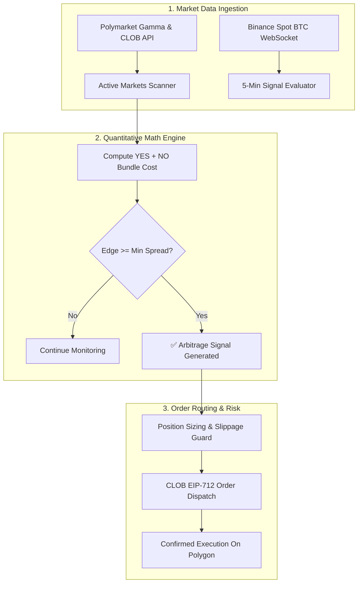

# ⚡ Polymarket Prediction Market & Arbitrage Trading Bot

[](https://python.org)
[](https://polymarket.com)
[](https://polygon.technology)
[](https://opensource.org/licenses/MIT)

> An algorithmic trading bot and mathematical arbitrage scanner engineered for **Polymarket Central Limit Order Book (CLOB)**. Detects complementary outcome mispricings ($YES + NO < \$1.00$), tracks 5-minute Bitcoin (BTC) price prediction events, and provides low-latency order execution with strict capital protection.

---

### 💼 Need Custom Prediction Market Bots, CLOB Connectors, or Arbitrage Engines?
I build institutional prediction market bots, event-driven arbitrage systems, and cross-platform hedging engines (Polymarket, Kalshi, Betfair).
* 💬 **Telegram:** [@JanzebBlockdev](https://t.me/JanzebBlockdev)
* 💼 **Upwork Profile:** [Upwork Verified Algorithmic Specialist](https://www.upwork.com/freelancers/~JanzebBlockdev)
* 📧 **Email:** `jahanzaibchanna70@gmail.com`

---

## 📑 Table of Contents
1. [Core Features](#-core-features)
2. [Mathematical Arbitrage Formula](#-mathematical-arbitrage-formula)
3. [Architecture & Pipeline](#-architecture--pipeline)
4. [Installation & Setup](#-installation--setup)
5. [Configuration (.env)](#-configuration-env)
6. [Simulation Mode](#-simulation-mode)
7. [Disclaimer](#-disclaimer)

---

## 🚀 Core Features

* **Outcome Bundle Mispricing Engine:** Scans liquid binary markets where $P(YES) + P(NO) < \$1.00$. Since complementary outcomes are guaranteed to resolve to exactly \$1.00 at settlement, buying both legs locks in mathematical profit.
* **5-Minute BTC Prediction Engine:** Tracks high-speed spot Bitcoin price movements and automatically executes positions on short-duration Polymarket prediction windows.
* **Polymarket CLOB API Integration:** Interacts directly with the Central Limit Order Book API via EIP-712 structured order signing.
* **Risk & Capital Safeguards:** Hardcoded maximum position sizes in USDC, concurrent exposure limits, and slippage bounds.
* **Interactive Terminal Dashboard:** Powered by `rich` to output live spread calculations, order book depths, and execution latency.

---

## 📐 Mathematical Arbitrage Formula

In binary prediction markets, two mutually exclusive outcomes (YES and NO) must resolve to \$1.00:

$$\text{Bundle Cost} = P(\text{YES}_{\text{ask}}) + P(\text{NO}_{\text{ask}})$$

$$\text{Guaranteed Spread Edge (\%)} = \left(\frac{1.00 - \text{Bundle Cost}}{1.00}\right) \times 100$$

When $\text{Bundle Cost} \le \$0.985$, the engine triggers simultaneous market orders to purchase equal quantities of both shares, capturing a **1.5%+ net yield** upon contract settlement with zero directional risk.

---

## 🏛️ Architecture & Pipeline



---

## 🛠️ Installation & Setup

### Prerequisites
* **Python:** 3.10, 3.11, or 3.12
* **Polygon Wallet:** A private key with USDC balance on the Polygon network

### Step 1: Clone & Setup Virtual Environment
```bash
git clone https://github.com/jahanzaib-codes/polymarket-prediction-arbitrage-bot.git
cd polymarket-prediction-arbitrage-bot

python -m venv venv
# Windows:
.\venv\Scripts\activate
# Linux/macOS:
source venv/bin/activate

pip install -r requirements.txt
```

### Step 2: Configuration
```bash
cp .env.example .env
```
Populate `.env` with your parameters:
```env
POLYGON_PRIVATE_KEY="YOUR_KEY"
TRADE_SIZE_USDC=50.0
MIN_ARBITRAGE_SPREAD_PERCENT=1.5
SIMULATION_MODE=true
```

### Step 3: Run the Bot
```bash
python main.py
```

---

## ⚙️ Configuration (.env)

| Parameter | Type | Default | Description |
| :--- | :--- | :--- | :--- |
| `TRADE_SIZE_USDC` | `float` | `50.0` | Order size in USDC per arbitrage leg. |
| `MIN_ARBITRAGE_SPREAD_PERCENT` | `float` | `1.5` | Minimum net edge required before firing orders. |
| `SIMULATION_MODE` | `boolean` | `true` | Allows full dry-run testing with zero real capital risk. |
| `MAX_OPEN_POSITIONS` | `int` | `5` | Maximum simultaneous open market commitments. |
| `ENABLE_5MIN_BTC_MARKETS` | `boolean` | `true` | Enables real-time short-term BTC prediction scans. |

---

## 🧪 Simulation Mode

By default, `SIMULATION_MODE=true` is enabled:
* Real-time prices are fetched live from Polymarket's production order books.
* When mispricings or trading opportunities occur, the engine prints simulated transaction receipts, calculates exact P&L yields, and measures execution latency without touching your wallet balance.


---

## ⚠️ Disclaimer

*This repository is for research, mathematical study, and educational use only. Automated interaction with financial and decentralized prediction markets carries inherent risks. The authors assume no liability for market losses.*

---
*Maintained by **Jahanzaib** ([@jahanzaib-codes](https://github.com/jahanzaib-codes))*

